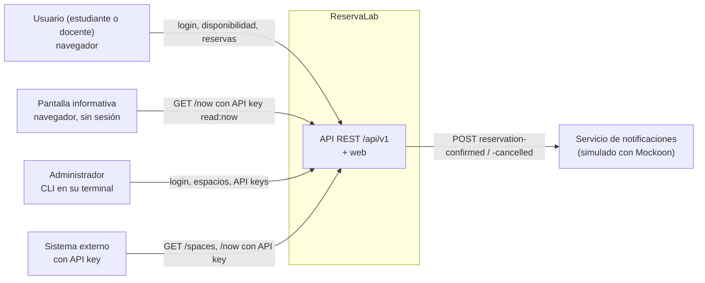
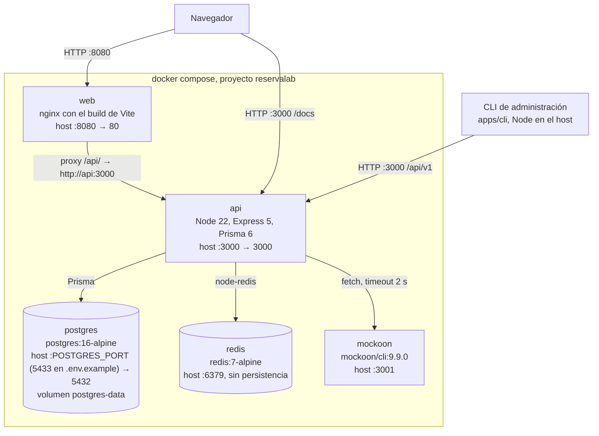
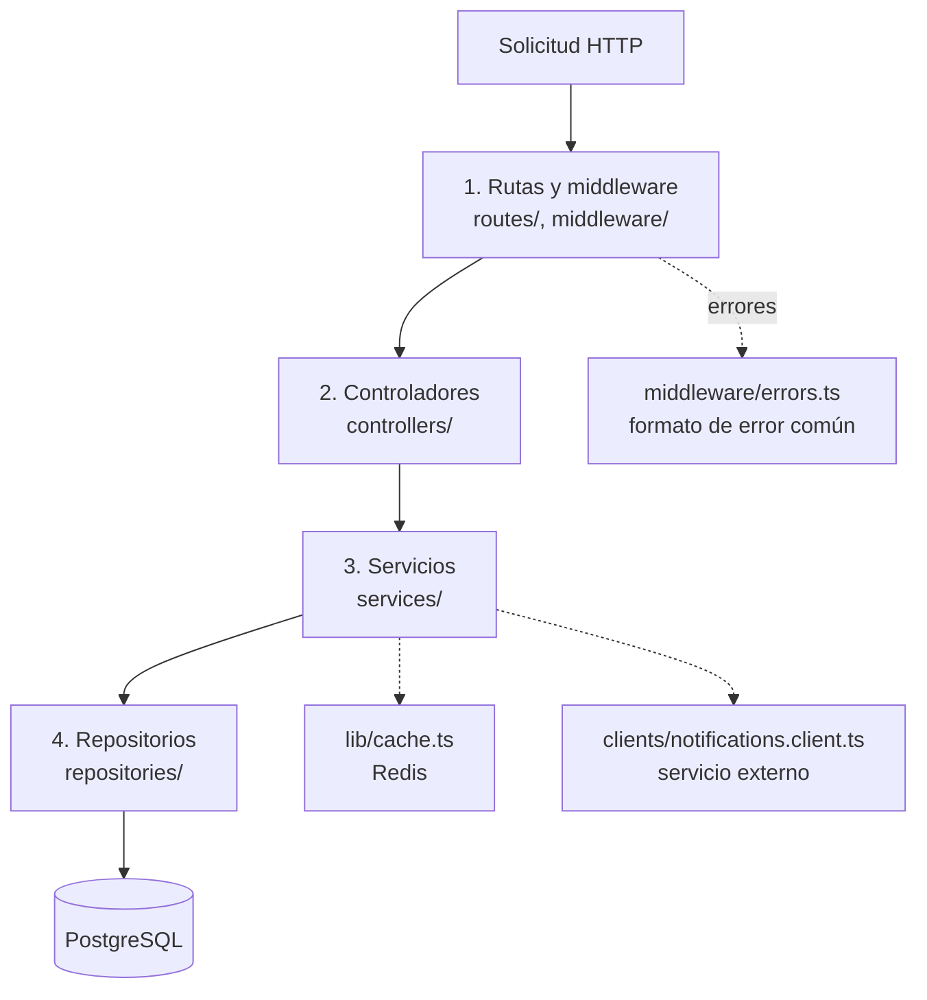
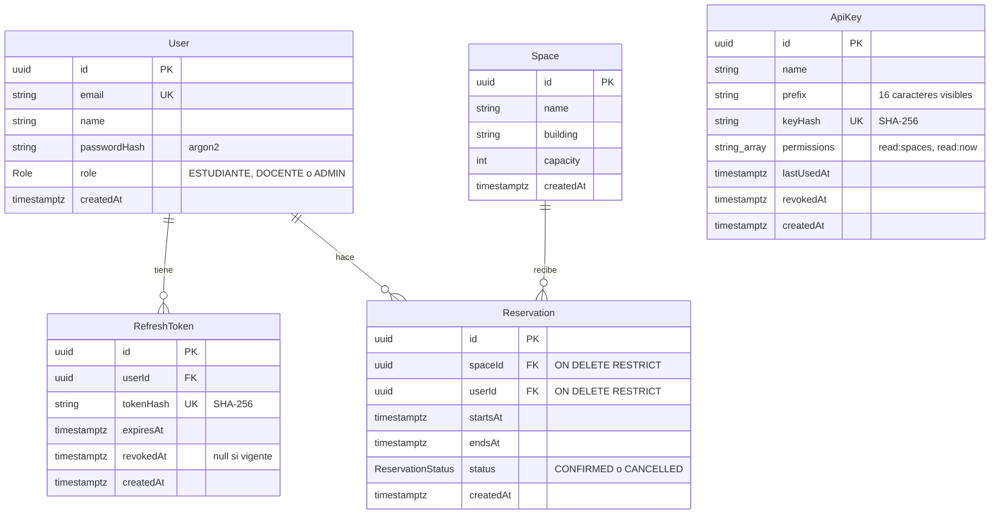
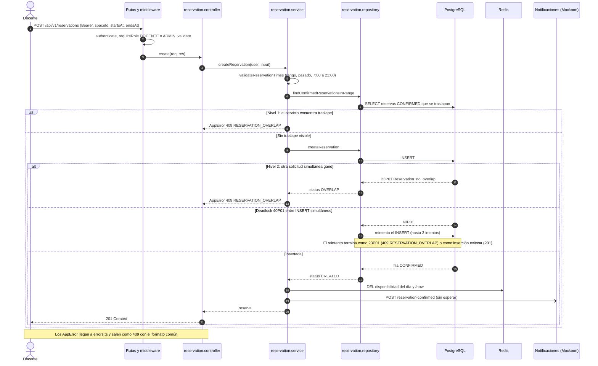
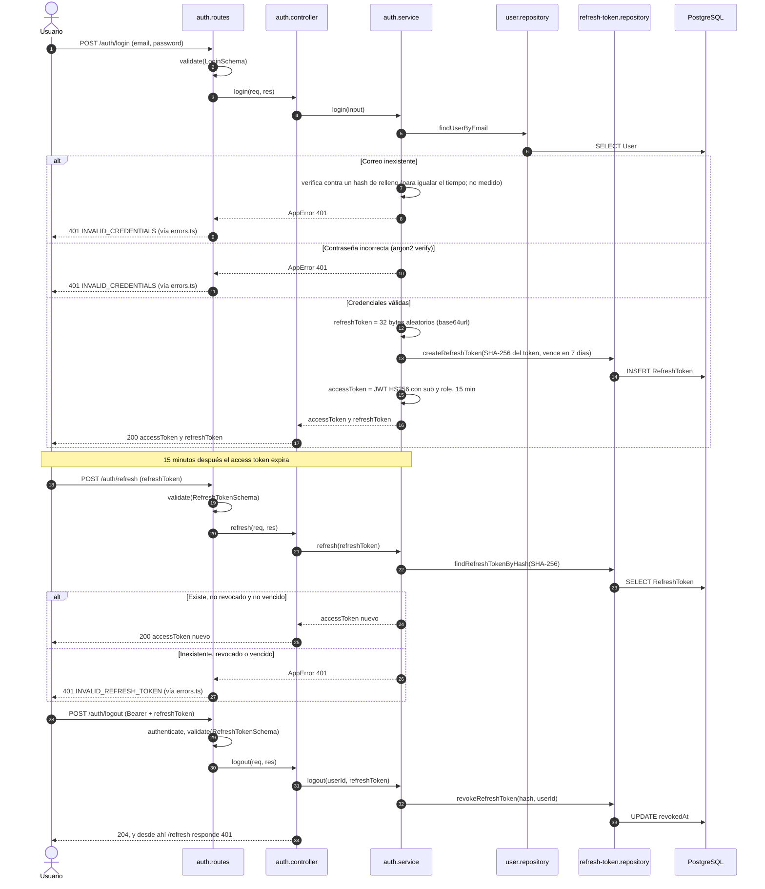

# Arquitectura de ReservaLab

Este documento describe la arquitectura tal como está en el repositorio. Cada afirmación remite a un archivo, una prueba, un ADR o una medición de `docs/benchmarks/`. Cuando un atributo no tiene medición en el repo, se indica **sin medición**.

## 1. Resumen y alcance

ReservaLab es un sistema para reservar laboratorios y salones (Arquitectura de Sistemas I, UMES Quetzaltenango). Resuelve un problema concreto: que dos personas no reserven el mismo espacio en horarios que se traslapan, y que cualquiera pueda consultar qué está libre.

**Qué incluye:**
- **Usuarios con tres roles** (`ESTUDIANTE`, `DOCENTE`, `ADMIN`): registro, login, renovación y cierre de sesión.
- **Espacios:** listado con filtros, alta, edición y borrado (solo ADMIN).
- **Disponibilidad por día** de cada espacio, dentro de la ventana de operación de 7:00 a 21:00, hora de Guatemala (`OPENING_HOUR` y `CLOSING_HOUR`).
- **Reservas:** crear (DOCENTE o ADMIN), ver las propias y cancelar (el dueño o un ADMIN).
- **API keys** para sistemas externos, con permisos `read:spaces` y `read:now` y un límite por minuto.
- **Pantalla informativa** (`GET /now`): el estado actual de cada espacio.
- **Aviso a un servicio externo de notificaciones** al confirmar o cancelar una reserva.

**Qué no incluye:** reservas que crucen de día, reservas recurrentes, borrado lógico de espacios ([ADR 0003](adr/0003-borrado-de-espacios.md)) ni límite de solicitudes para usuarios con JWT ([ADR 0006](adr/0006-api-keys-y-limite-de-solicitudes.md)).

## 2. Vista de contexto



| Actor | Cómo entra | Qué puede hacer |
|---|---|---|
| Usuario (ESTUDIANTE, DOCENTE) | Web (`apps/web`) con JWT | Ver espacios y disponibilidad. El DOCENTE además reserva y cancela sus reservas. |
| Administrador | CLI (`apps/cli`) o Swagger UI, con JWT de un ADMIN | Crear, editar y borrar espacios, y crear, listar y revocar API keys. |
| Pantalla informativa | Web, ruta `#/pantalla`, con la API key de `VITE_INFO_API_KEY` | Solo `GET /now` (permiso `read:now`). |
| Sistema externo | HTTP con cabecera `X-API-Key` | Lo que permitan sus permisos: `read:spaces` y/o `read:now`. |
| Servicio de notificaciones | Lo llama la API, nunca al revés | Recibe los avisos. En este repo lo simula Mockoon (`packages/mocks/notifications.json`), que responde 202 en las dos rutas. |

## 3. Vista de contenedores y despliegue

Todo lo que corre en servidor se levanta con `docker compose up` ([`docker-compose.yml`](../docker-compose.yml)). La CLI no es un contenedor: corre en la máquina del administrador y llama a la API por HTTP.



| Servicio | Imagen o build | Función | Arranque |
|---|---|---|---|
| `postgres` | `postgres:16-alpine` | Datos de usuarios, espacios, reservas, refresh tokens y API keys | Healthcheck con `pg_isready` |
| `redis` | `redis:7-alpine` con `--save "" --appendonly no` | Caché de lecturas y contadores del límite por minuto. Sin persistencia a propósito ([ADR 0007](adr/0007-cache-con-redis.md)). | Healthcheck con `redis-cli ping` |
| `mockoon` | `mockoon/cli:9.9.0` | Simula el servicio de notificaciones | Sin healthcheck propio |
| `api` | `apps/api/Dockerfile` (3 etapas) | API REST y Swagger UI en `/docs` | Espera a que `postgres` y `redis` estén sanos. Luego `prisma migrate deploy`, el seed idempotente y el servidor. Healthcheck contra `/api/v1/health`. |
| `web` | `apps/web/Dockerfile` | Archivos estáticos con nginx, que reenvía `/api/` a la API (mismo origen, sin CORS) | Espera a que `api` esté sana |

Dentro de la red de Docker los servicios se llaman por su nombre (`postgres`, `redis`, `mockoon`, `api`). El servicio `api` reemplaza las URL de `.env`, que apuntan a `localhost` para el desarrollo fuera de Docker.

## 4. Vista de capas de la API

Cada solicitud cruza cuatro capas en orden ([ADR 0001](adr/0001-express-prisma-monorepo.md)).



| Capa | Responsabilidad | Ejemplo real |
|---|---|---|
| 1. Rutas y middleware | Declarar la ruta y encadenar autenticación (JWT o API key), rol, validación con Zod y límite por minuto | `routes/reservation.routes.ts`: `authenticate` → `requireRole('DOCENTE', 'ADMIN')` → `validate(CreateReservationSchema)` → `reservationController.create` |
| 2. Controladores | Traducir HTTP a una llamada de servicio y el resultado a una respuesta. Sin reglas de negocio, sin Prisma. | `controllers/reservation.controller.ts`: `create` llama a `createReservation(getAuthUser(req), req.body)` y responde 201 |
| 3. Servicios | Todas las reglas de negocio: horarios, traslape, permisos sobre la reserva, caché y notificaciones | `services/reservation.service.ts`: valida el horario y la ventana de operación, busca traslapes, crea, invalida la caché y notifica |
| 4. Repositorios | Único código que usa Prisma. No conoce `req` ni `res`. Traduce errores de la base a resultados del dominio. | `repositories/reservation.repository.ts`: `createReservation` devuelve `{ status: 'OVERLAP' }` ante la restricción EXCLUDE y reintenta ante un deadlock |

**Cómo se cumple:** ninguna ruta, middleware, controlador ni servicio importa Prisma. Se comprueba con `grep -rln "lib/prisma\|@prisma/client" apps/api/src`, que solo encuentra:
- `src/lib/prisma.ts`, donde se crea el cliente.
- Los archivos de `src/repositories/`.
- `src/server.ts`, el punto de arranque, que solo llama a `prisma.$disconnect()` al apagar el proceso. Los errores async llegan solos a `middleware/errors.ts` gracias a Express 5. Ese middleware los convierte al formato `{ error: { code, message, details? } }` (`ErrorResponseSchema` de `packages/shared`). Un error no controlado se responde como 500 genérico, sin mensaje ni stack.

**Fuera de las cuatro capas, a propósito:**
- `clients/notifications.client.ts` habla con otro sistema, no persiste datos ([ADR 0005](adr/0005-notificaciones-tolerantes-a-fallos.md)).
- `lib/cache.ts` es la caché con Redis.
- `docs/` genera OpenAPI desde los esquemas Zod ([ADR 0008](adr/0008-documentacion-openapi-desde-zod.md)).

## 5. Vista de datos

Entidades de [`apps/api/prisma/schema.prisma`](../apps/api/prisma/schema.prisma):



`ApiKey` no tiene relación con `User`: identifica a un sistema externo, no a una persona.

**Restricciones que Prisma no expresa.** Viven en la migración SQL manual [`20261029015948_reservation_constraints`](../apps/api/prisma/migrations/20261029015948_reservation_constraints/migration.sql):

```sql
CREATE EXTENSION IF NOT EXISTS btree_gist;

ALTER TABLE "Reservation"
  ADD CONSTRAINT "Reservation_no_overlap"
  EXCLUDE USING gist (
    "spaceId" WITH =,
    tstzrange("startsAt", "endsAt", '[)') WITH &&
  )
  WHERE ("status" = 'CONFIRMED');

ALTER TABLE "Reservation"
  ADD CONSTRAINT "Reservation_endsAt_after_startsAt"
  CHECK ("endsAt" > "startsAt");
```

- **Qué impide:** dos reservas `CONFIRMED` del mismo espacio con rangos que se crucen.
- **Contiguas permitidas:** el rango `[)` incluye el inicio y excluye el fin, así que una reserva que termina a las 10:00 y otra que empieza a las 10:00 conviven.
- **Canceladas:** el `WHERE` hace que no bloqueen.
- **`btree_gist`:** permite combinar la igualdad de `uuid` con el traslape de rangos en un mismo índice GiST.

## 6. Flujos clave

### a) Crear una reserva, con el traslape protegido en dos niveles



El nivel 1 da un mensaje claro sin intentar el INSERT. El nivel 2 es la única garantía real ante la concurrencia ([ADR 0004](adr/0004-proteccion-de-traslapes.md)). El aviso no bloquea la respuesta: si falla o pasa de `NOTIFICATIONS_TIMEOUT_MS`, solo se registra ([ADR 0005](adr/0005-notificaciones-tolerantes-a-fallos.md)).

### b) Login con access token JWT y refresh token opaco



El access token no consulta la base al verificarse: lo valida `middleware/authenticate.ts` con la firma. El refresh token solo se guarda como hash ([ADR 0002](adr/0002-autenticacion-jwt.md)).

## 7. Atributos de calidad medibles

Las cifras de cobertura y de pruebas salen de ejecutar `pnpm test:coverage` y `pnpm test:integration` el 2026-11-10, sobre la rama `test/cobertura-cli-web`. Los tiempos salen de [docs/benchmarks/cache.md](benchmarks/cache.md).

### Integridad

| Atributo | Métrica | Cómo se mide | Resultado |
|---|---|---|---|
| No hay reservas traslapadas | Reservas `CONFIRMED` por horario tras dos `POST` simultáneos al mismo horario | `test/integration/reservation-concurrency.int.test.ts`: 5 horarios (8, 10, 12, 14 y 16 h), dos `POST` en paralelo en cada uno, contra PostgreSQL real | En los 5 casos, exactamente un 201 y un 409, y 1 sola reserva `CONFIRMED` |
| La base rechaza el traslape aunque se salte el servicio | Resultado de un INSERT traslapado directo al repositorio | Misma prueba, caso «la restricción EXCLUDE rechaza el traslape…» | Devuelve `OVERLAP` |
| Carrera sin errores 500 | Respuestas 500 en INSERT simultáneos | Prueba de integración anterior. El [ADR 0004](adr/0004-proteccion-de-traslapes.md) registra que, antes de reintentar ante el 40P01, la API respondía 500 en 3 de 4 ejecuciones. | 0 respuestas 500 en las 5 carreras de la prueba actual |
| Flujo completo desde un clon limpio | Pasos del flujo que dan el resultado esperado, incluida la reserva traslapada rechazada | [`scripts/prueba-clon-limpio.sh`](../scripts/prueba-clon-limpio.sh): clona la rama, levanta con `docker compose up --build` y recorre 15 pasos (login, espacios, reserva, traslape, caché, `/docs`, `/now` y web). Ejecuta `docker compose down -v` sobre la copia local. | 15 de 15 el 2026-11-09; el traslape da 409 `RESERVATION_OVERLAP` |

### Rendimiento

| Atributo | Métrica | Cómo se mide | Resultado |
|---|---|---|---|
| Latencia de disponibilidad con caché | p50 y p95, en ms, de `GET /spaces/:id/availability` | `pnpm --filter @reservalab/api bench:cache`: 200 solicitudes MISS y 200 HIT, secuenciales, contra el contenedor (condiciones en [docs/benchmarks/cache.md](benchmarks/cache.md)) | Ejecución 2: MISS p50 6,07 y p95 8,11; HIT p50 2,27 y p95 3,24. Mejora de 2,7× en p50 y 2,5× en p95. En las tres ejecuciones, la mejora en p50 va de 2,3× a 2,7×. |
| La caché se invalida al escribir | `X-Cache` antes y después de reservar | `test/integration/cache.int.test.ts` (4 casos) | MISS → HIT; después de reservar, MISS con el bloque ocupado; un espacio no contamina a otro; los 400 y 404 no se cachean |
| Latencia bajo carga concurrente | p95 con N clientes simultáneos | — | **Sin medición.** El benchmark es secuencial, como aclara el propio documento. |
| Latencia de crear reserva, login y otros endpoints | p50 y p95 | — | **Sin medición.** Solo hay una observación puntual en el [ADR 0005](adr/0005-notificaciones-tolerantes-a-fallos.md): con Mockoon detenido, una reserva respondió 201 en 314 ms. |

### Seguridad

| Atributo | Métrica | Cómo se mide | Resultado |
|---|---|---|---|
| Contraseñas con hash lento | Algoritmo y que no se devuelva el hash | `lib/password.ts` usa `@node-rs/argon2`. `auth.service.test.ts`: «crea el usuario con la contraseña hasheada y no devuelve el hash» | argon2, con los parámetros por defecto de la librería |
| Login sin revelar qué falló | Misma respuesta para correo inexistente y contraseña incorrecta | `auth.service.test.ts`: «responde 401 genérico…» y «con usuario inexistente igual compara la contraseña (contra un hash de relleno)» | El mismo 401 `INVALID_CREDENTIALS`, y la verificación de argon2 corre en ambos casos. El tiempo de respuesta igualado está **sin medición**. |
| Refresh token revocable y guardado como hash | `/refresh` después de logout, con token vencido o inexistente | `auth.service.test.ts`: casos «expirado», «revocado» e «inexistente», y «guarda solo el hash del refresh token» | 401 `INVALID_REFRESH_TOKEN` en los tres casos. En la base solo hay el SHA-256. |
| API keys revocables, con permisos explícitos | Código HTTP antes y después de revocar, y con un permiso que no tiene | `test/integration/api-keys-now.int.test.ts` | 200 → revocar → 401; una key sin `read:now` recibe 403 |
| Límite por API key | 429 al pasar el límite por minuto | `middleware/rate-limit.test.ts` y `services/rate-limit.service.test.ts` (Redis simulado) | 429 con `Retry-After`; cabeceras `X-RateLimit-*`; las solicitudes con JWT no cuentan. Valor por defecto: 60 por minuto (`API_KEY_RATE_LIMIT_PER_MINUTE`). Bajo carga real: **sin medición**. |
| Errores sin detalles internos | Lo que recibe el cliente ante un error no controlado | `middleware/errors.test.ts`: «responde 500 genérico sin filtrar el mensaje ni el stack…» | 500 `INTERNAL_ERROR` con un mensaje genérico. El detalle queda solo en el log. |
| Web sin `innerHTML` | Archivos que usan `innerHTML`, `outerHTML`, `insertAdjacentHTML` o `document.write` | `apps/web/src/no-inner-html.test.ts` | 0 ([ADR 0009](adr/0009-web-sin-frameworks.md)) |
| Resistencia a ataques (pentest, escaneo de dependencias) | — | — | **Sin medición** |

### Mantenibilidad

| Atributo | Métrica | Cómo se mide | Resultado |
|---|---|---|---|
| Cobertura de la API | % de lines, statements, branches y functions; umbral de 70 % en las cuatro ([`coverage.thresholds.json`](../coverage.thresholds.json)) | `pnpm test:coverage` (Vitest con v8), 234 pruebas | Lines 83,62 %, statements 83,98 %, branches 83,47 %, functions 72,62 %. Pasa el umbral. |
| Cobertura de la CLI | Igual | `pnpm test:coverage`, 67 pruebas aprobadas y 1 omitida | Lines 95,60 %, statements 94,84 %, branches 95,37 %, functions 94,33 %. Sin umbral. |
| Cobertura de la web | Igual | `pnpm test:coverage`, 53 pruebas | Lines 42,27 %, statements 43,65 %, branches 49,75 %, functions 51,64 %. Sin umbral. |
| Pruebas de integración | Pruebas que pasan contra PostgreSQL y Redis reales | `pnpm test:integration` | 12 de 12 (3 archivos) |
| Separación en 4 capas | Rutas, middleware, controladores o servicios que importan Prisma | `grep` sobre `apps/api/src` (ver sección 4) | 0. Fuera de los repositorios solo lo importan `lib/prisma.ts` y `server.ts` (para desconectar al apagar). No hay regla de lint ni prueba que lo haga cumplir solo. |
| Contrato documentado | Rutas de Express ausentes en OpenAPI | `docs/openapi.test.ts` recorre los routers y compara con el documento | 0 (la prueba falla si falta una) |
| Integración continua | Ejecuciones en verde en GitHub Actions | `.github/workflows/ci.yml`, PR #1 | Typecheck, pruebas unitarias, cobertura e integración pasaron en GitHub Actions. |

## 8. Decisiones

| ADR | Decisión | Estado |
|---|---|---|
| [0001](adr/0001-express-prisma-monorepo.md) | Express 5, Prisma 6 y monorepo con pnpm y Turborepo | Aceptada |
| [0002](adr/0002-autenticacion-jwt.md) | Access token JWT de 15 min y refresh token opaco de 7 días, guardado como SHA-256 | Aceptada |
| [0003](adr/0003-borrado-de-espacios.md) | Un espacio con reservas vigentes no se borra (409). Si no tiene, se borra con su historial. | Aceptada |
| [0004](adr/0004-proteccion-de-traslapes.md) | Traslape protegido en el servicio y con `EXCLUDE USING gist`, con reintento ante deadlock | Aceptada |
| [0005](adr/0005-notificaciones-tolerantes-a-fallos.md) | Notificaciones sin esperar respuesta, con timeout, que nunca revierten la reserva | Aceptada |
| [0006](adr/0006-api-keys-y-limite-de-solicitudes.md) | API keys `rl_live_` guardadas como SHA-256, con permisos explícitos y límite por minuto en Redis que deja pasar si Redis falla | Aceptada |
| [0007](adr/0007-cache-con-redis.md) | Caché de 60 s en Redis para `/spaces`, disponibilidad y `/now`, con invalidación explícita y `X-Cache` | Aceptada |
| [0008](adr/0008-documentacion-openapi-desde-zod.md) | OpenAPI generado desde los esquemas Zod de `shared` | Aceptada |
| [0009](adr/0009-web-sin-frameworks.md) | Web en TypeScript sin frameworks, servida por nginx | Aceptada |

## 9. Limitaciones conocidas

**Pruebas y calidad**
- **Cobertura de la CLI y la web sin umbral.** En la última medición, la CLI está en 95,60 % de lines y 94,33 % de functions; la web, en 42,27 % de lines y 51,64 % de functions. El umbral de 70 % solo se exige a la API.
- **Las pruebas contra Mockoon aún no están integradas en `main`.** El PR #1 las agrega y sus checks de CI pasaron; mientras siga abierto, `main` conserva la cobertura anterior.
- **No hay ESLint.** El paso de lint del CI es `tsc --noEmit`, y la regla de capas se cumple por convención.
- **El margen de la API en functions es corto:** 72,62 % contra el umbral de 70 %.

**Rendimiento**
- **Una sola medición, secuencial, en un solo equipo.** No hay pruebas de carga ni de concurrencia sobre la latencia.

**Seguridad** ([ADR 0002](adr/0002-autenticacion-jwt.md), [ADR 0006](adr/0006-api-keys-y-limite-de-solicitudes.md), [ADR 0009](adr/0009-web-sin-frameworks.md))
- **El access token no se puede revocar.** Vale hasta 15 minutos después del logout, y un cambio de rol tarda hasta 15 minutos en reflejarse.
- **El refresh token no rota.** Si lo roban, sirve hasta que venza (7 días) o se haga logout.
- **La tabla `RefreshToken` crece con cada login.** No hay tarea que borre los vencidos o revocados.
- **La web guarda los tokens en `localStorage`.** Un XSS podría leerlos; se mitiga con la regla de no usar `innerHTML`.
- **Límites que no cubren todo:**
  - Mientras Redis esté caído no hay límite por API key.
  - En el cruce entre dos minutos, una key puede hacer hasta el doble del límite.
  - Las solicitudes con JWT no tienen límite.

**Funcionamiento**
- **Las notificaciones se pueden perder.** No hay reintentos, y el orden de llegada no está garantizado ([ADR 0005](adr/0005-notificaciones-tolerantes-a-fallos.md)).
- **Datos viejos posibles en la caché** hasta 60 s si una invalidación falla o en la carrera descrita en el [ADR 0007](adr/0007-cache-con-redis.md). `/now` usa una sola clave para todos los espacios. La protección contra traslapes no depende de la caché.
- **La detección de 23P01 y 40P01 depende del texto del mensaje de Prisma 6.** Hay que volver a probar al actualizar Prisma ([ADR 0004](adr/0004-proteccion-de-traslapes.md)).
- **Borrar un espacio borra su historial de reservas** ([ADR 0003](adr/0003-borrado-de-espacios.md)).

**Operación**
- **Prisma 7 queda pendiente.** Cada arranque avisa que `package.json#prisma` desaparece en esa versión.
- **El seed corre en cada arranque.** Crea cuentas con una contraseña conocida (`SEED_USER_PASSWORD`, solo para desarrollo) y vuelve a crear los espacios de ejemplo si se borran.
- **`docker-compose.yml` fija `name: reservalab`.** Dos copias del repo comparten contenedores y volumen.
